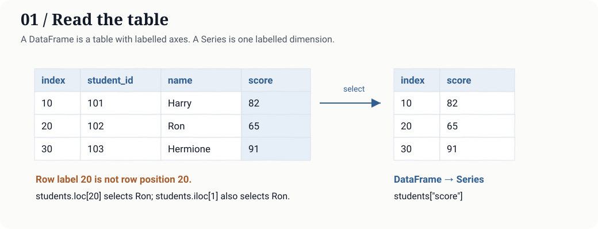
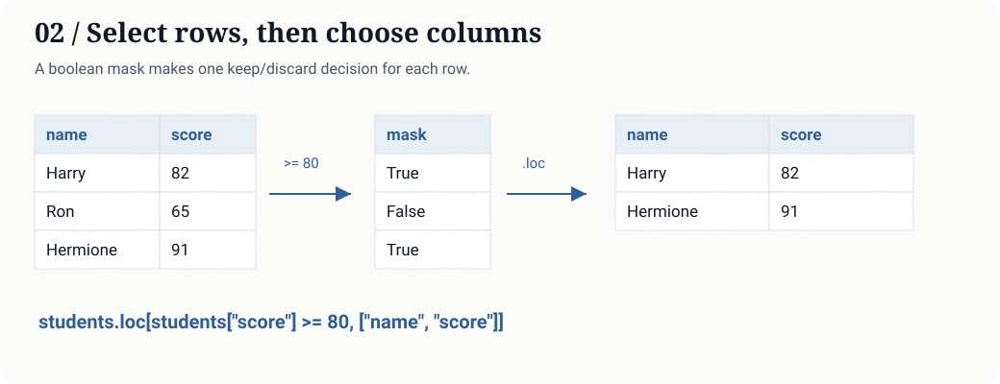
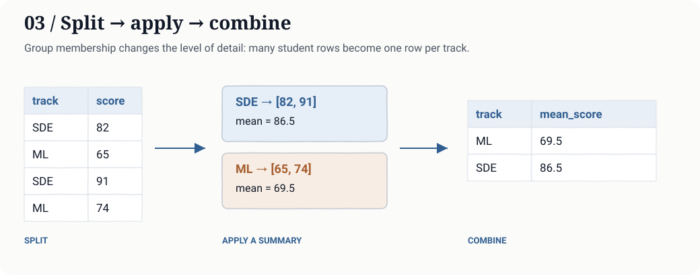
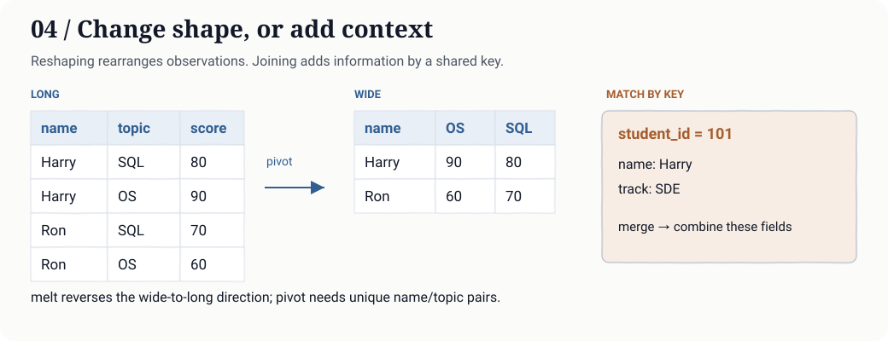

# Pandas Basics

*A self-help guide to understanding, practising, and revising pandas.*

**Python for data work · Learning guide 01 · Updated 18 October 2026**

A table becomes useful when I can answer a question with it: which rows match a condition, what needs cleaning, or how a group compares with another. pandas gives these recurring tasks a small, consistent vocabulary.

The guide follows a practical sequence: understand the table, select data, make changes, clean carefully, then summarize. Read it once to build the ideas; return to the parameter tables and worked exercises when you need to revise or solve a similar problem.

**Before you begin:** basic Python lists, dictionaries, functions, and comparisons. No NumPy, SQL, or machine learning background is required. Read sections 1–5 first; return to the exercises and reference tables over several short sessions.

Before choosing a method, ask **what one row represents**. That tells you whether an operation should retain individual records, combine them, or turn them into summaries.

## In this guide

1. [What is pandas?](#what-is-pandas)
2. [Set up your environment](#set-up-your-environment)
3. [Read a DataFrame](#read-a-dataframe)
4. [Select and transform](#select-and-transform)
5. [Clean without losing meaning](#clean-without-losing-meaning)
6. [Summarize, combine, and reshape](#summarize-combine-and-reshape)
7. [Worked example: summarize benchmark runs](#worked-example-summarize-benchmark-runs)
8. [Fifteen exercises, with hidden solutions](#fifteen-exercises-with-hidden-solutions)
9. [Interview questions and quick reference](#interview-questions-and-quick-reference)
10. [Sources and next steps](#sources-and-next-steps)

## What is pandas?

pandas is an open-source Python library for working with <mark>labelled data</mark>, particularly tables. It provides tools to read files, inspect columns, select records, handle missing values, calculate summaries, and combine datasets.

Its two central objects are a **DataFrame**, a two-dimensional table, and a **Series**, a one-dimensional collection of values with an index. A DataFrame can hold different types in different columns: names, integer counts, decimal measurements, dates, or categories.

A useful comparison:

| Tool | Where it fits |
|---|---|
| Python lists and dictionaries | General-purpose structures; convenient for small custom tasks |
| NumPy | Arrays and numerical operations, especially when array shape and numeric computation dominate |
| pandas | Labelled tables: cleaning, exploration, joins, grouping, and reporting |
| SQL/database | Persistent data, queries close to storage, transactions, and shared access |

These tools often work together. You might query PostgreSQL, inspect the result in pandas, and pass numeric features to a model.

pandas usually works with data in memory. A CSV's file size is not a reliable estimate of the memory its parsed table will consume. If a dataset is large, read fewer columns, process suitable operations in chunks, or push work into a database. The [official beginner tutorials](https://pandas.pydata.org/docs/getting_started/intro_tutorials/) are a useful companion to this guide.

## Set up your environment

Use a project-specific virtual environment so experiments do not interfere with other projects. A compatible Python installation is required; if Python is missing, begin with the [official Python downloads](https://www.python.org/downloads/).

**macOS or Linux**

```bash
python3 -m venv .venv
source .venv/bin/activate
python -m pip install pandas
```

**Windows PowerShell**

```powershell
py -m venv .venv
.\.venv\Scripts\python.exe -m pip install pandas
```

On Windows you can use the environment's interpreter directly, without changing PowerShell's script policy:

```powershell
.\.venv\Scripts\python.exe your_script.py
```

Check the interpreter you intend to use:

```bash
python -c "import pandas as pd; print(pd.__version__)"
```

For Windows without an activated environment, replace `python` with `.\.venv\Scripts\python.exe`. In a notebook, select the kernel belonging to that same environment.

Import pandas using its conventional short name:

```python
import pandas as pd
```

**Version note.** The accompanying examples were checked with pandas 2.2.3; assignment examples were also checked with its Copy-on-Write option enabled. Current pandas 3.x uses Copy-on-Write by default. The patterns here avoid chained assignment, but exact inferred string dtypes and printed formatting can vary between versions. See the [installation guide](https://pandas.pydata.org/docs/getting_started/install.html) and [Copy-on-Write guide](https://pandas.pydata.org/docs/user_guide/copy_on_write.html).

## Read a DataFrame

### One small table to learn with

Imagine Harry, Ron, Hermione, and Neville at a coding workshop. The scores and ages in these examples are invented practice data; the characters simply make the rows easier to remember.

Use this setup for the examples in sections 3–6. Each later example starts from this table unless it defines another input. Examples that modify a table make a copy so you can try them independently.

```python
students = pd.DataFrame({
    "student_id": [101, 102, 103, 104],
    "name": ["Harry", "Ron", "Hermione", "Neville"],
    "track": ["SDE", "ML", "SDE", "ML"],
    "score": [82, 65, 91, 74],
}, index=[10, 20, 30, 40])
print(students)
```

```text
    student_id      name track  score
10         101     Harry   SDE     82
20         102       Ron    ML     65
30         103  Hermione   SDE     91
40         104   Neville    ML     74
```

The leftmost labels, `10, 20, 30, 40`, are the **index**. They are not a fifth data column. Here, a row represents one student; `student_id` is an ordinary column containing the application's identifier.



### The vocabulary

| Term | Meaning in this example |
|---|---|
| Row / observation | One student's record |
| Column / variable | One field, such as `score` |
| Index | Labels used to identify rows in pandas; labels need not be consecutive or unique |
| Series | One labelled dimension; `students["score"]` returns a Series |
| DataFrame | A table; `students[["score"]]` returns a one-column DataFrame |
| `dtype` | A column's storage/type representation |
| Missing value | An unavailable value, represented differently according to dtype |
| Axis | Rows are axis 0; columns are axis 1 |

<p class="hand-note">Filtering removes rows, not their labels. If label 20 disappears, the remaining labels are still 10, 30, 40; the third row is reached by position 2 or label 40. Resetting the index is a separate choice.</p>

The index is **not automatically a database primary key**. If uniqueness matters, check it with `students.index.is_unique`, or validate an explicit ID column.

### Inspect before changing anything

```python
print(students.shape)           # (4, 4): rows, columns
print(students.size)            # 16: total cells, including missing cells
print(len(students))            # 4: rows
print(students.columns.tolist())
print(students.head(2))
print(students.dtypes)
students.info()                 # prints structure and non-missing counts
print(students.describe())      # numeric summary by default
```

`info()` prints its report and returns `None`; use `students.info()`, rather than `print(students.info())`. `describe()` does not establish that the data is valid. Look for impossible values, duplicate identifiers, and unexpected units yourself.

### Read and write files

```python
from io import StringIO

csv_text = "student_id,name,score\n101,Harry,82\n102,Ron,65\n"
loaded = pd.read_csv(StringIO(csv_text))
print(loaded.shape)             # (2, 3)
```

With a real file, replace `StringIO(csv_text)` with a path. These lines expect an input file and write an output file:

```python
loaded = pd.read_csv("students.csv", usecols=["student_id", "name", "score"])
loaded.to_csv("students_clean.csv", index=False)
```

`index=False` leaves pandas' row labels out of the CSV. Include an index deliberately if it carries useful information. For identifiers such as `"0012"`, specify a string dtype while reading so leading zeros survive.

Useful CSV arguments when moving beyond the toy input:

| Argument | Purpose | Example choice |
|---|---|---|
| `usecols` | Read only needed fields | `['student_id', 'name', 'score']` |
| `dtype` | Preserve an intended representation | `{'student_id': 'string'}` keeps leading zeros |
| `na_values` | Recognize extra missing-value tokens | `['absent', '?']`, if those tokens mean missing in this file |
| `parse_dates` | Request date parsing for selected fields | `['recorded_at']`; check the resulting dtype if input is inconsistent |
| `chunksize` | Read batches through an iterator | `10000` rows per chunk; later operations must combine chunk results correctly |

These options describe an input contract; they do not establish that the values are valid. See [read_csv parameters](https://pandas.pydata.org/docs/reference/api/pandas.read_csv.html).

pandas also supports JSON, Excel, Parquet, and SQL inputs. Some formats need optional dependencies; CSV is enough to begin. See the [reading and writing tutorial](https://pandas.pydata.org/docs/getting_started/intro_tutorials/02_read_write.html).

## Select and transform

### Labels and positions answer different questions

| Expression | Result |
|---|---|
| `students["name"]` | A Series of names |
| `students[["name", "score"]]` | A DataFrame with two columns |
| `students.loc[20, "name"]` | `"Ron"`: row **label** 20 |
| `students.iloc[1, 1]` | `"Ron"`: second row, second column by **position** |
| `students.loc[10:30]` | Labels 10 through 30, including 30 in this ordered index |
| `students.iloc[0:2]` | Positions 0 and 1; stop position 2 is excluded |

Use `.loc[row_selector, column_selector]` when labels or conditions express the task. Use `.iloc` when positions express it. For a single cell, `.at[label, column]` and `.iat[row_position, column_position]` are also available. Details: [indexing and selection](https://pandas.pydata.org/docs/user_guide/indexing.html).

### A filter is a sequence of decisions

```python
mask = students["score"] >= 80
selected = students.loc[mask, ["name", "score"]]
print(selected)
```

```text
        name  score
10     Harry     82
30  Hermione     91
```



Combine conditions with `&` for AND, `|` for OR, and `~` for NOT. Parenthesize each comparison:

```python
selected = students.loc[
    (students["track"] == "SDE") & (students["score"] >= 85),
    ["name", "score"],
]
print(selected["name"].tolist())   # ['Hermione']
```

Python's `and` and `or` expect a single truth decision; a Series contains many. To test membership, use `.isin(["SDE", "ML"])`.

### Work on whole columns

```python
scored = students.copy()
scored["score_fraction"] = scored["score"] / 100
scored["passed"] = scored["score"] >= 70
print(scored["passed"].tolist())   # [True, False, True, True]
```

This style expresses a column operation directly instead of writing an explicit row loop. Prefer built-in arithmetic, comparisons, `.str` operations, and aggregations before reaching for `.apply()`.

Vectorized syntax is not a universal speed guarantee; memory, dtype, and the particular operation matter. For custom logic, `.apply()` can be useful, but `axis=1` often invokes Python once per row.

### Make assignments explicit

```python
updated = students.copy()
updated.loc[updated["student_id"] == 102, "score"] = 70
```

Avoid writing through an intermediate selection such as `updated[updated["student_id"] == 102]["score"] = 70`. Under Copy-on-Write it does not update the original table. Select the intended rows and column in a **single `.loc` assignment**.

### Sort, rename, and chain

```python
ranked = (
    students
    .sort_values(["score", "student_id"], ascending=[False, True])
    .rename(columns={"score": "marks"})
    .reset_index(drop=True)
)
print(ranked["name"].tolist())   # ['Hermione', 'Harry', 'Neville', 'Ron']
```

A secondary sort key makes ties predictable. `reset_index(drop=True)` gives the result consecutive row labels; it does not sort anything. Chaining reads as a sequence of transformations, but naming intermediate results is often easier while debugging.

Most transformations return an object you must use or assign. `inplace=True` is not a general promise of lower memory use or better performance.

## Clean without losing meaning

Real tables contain inconsistent text, missing entries, duplicate records, and numbers stored as strings. Cleaning requires decisions about what those entries mean.

### Missing is different from zero

```python
raw = pd.DataFrame({
    "name": [" Harry ", "Ron", None],
    "score": ["82", "absent", "91"],
})
raw["name"] = raw["name"].astype("string").str.strip()
raw["score"] = pd.to_numeric(raw["score"], errors="coerce").astype("Int64")
print(raw["score"].isna().tolist())    # [False, True, False]
print(raw["score"].mean())            # 86.5: missing values are skipped
```

<p class="hand-note">The two known scores, 82 and 91, average to 86.5. Filling the missing score with zero changes that average to 57.67. The operation succeeds either way; the meaning of the result changes.</p>

`errors="coerce"` converts an unparseable number into a missing entry. That is convenient, but it can hide bad input: count or preserve the original invalid values if quality matters.

`Int64`, with a capital `I`, is pandas' nullable integer dtype; it can hold integers and `pd.NA`. Plain `int64` cannot directly represent missing integers. Other dtypes can use `NaN`, `NaT`, or `None`-like values. Use `.isna()` and `.notna()` to detect missing entries rather than equality comparisons. The [missing-data guide](https://pandas.pydata.org/docs/user_guide/missing_data.html) explains the representations.

Choose an action based on the task:

```python
with_names = raw.dropna(subset=["name"])
labelled = raw.assign(name=raw["name"].fillna("Unknown"))
```

Dropping a missing name may be appropriate for a name directory. Replacing an absent exam score with zero changes its meaning. Filling a feature with the mean might be reasonable in an ML pipeline, but the fill value must be learned from the training split to avoid leakage.

For a group, `.size()` counts rows while `.count()` counts non-missing values in the selected column. Report both when missingness matters.

### Duplicate according to which key?

```python
contacts = pd.DataFrame({
    "name": ["Harry", "Ron", "Harry revised"],
    "email": ["harry@example.test", "ron@example.test", "harry@example.test"],
})
unique = contacts.drop_duplicates(subset=["email"], keep="first")
print(len(unique))   # 2
```

Two rows can be duplicates by email even when their names differ. Define the business key first. If you intend to retain the latest record, sort by a trustworthy timestamp before using `keep="last"`.

### Text, dates, and types

| Task | Pattern |
|---|---|
| Trim and normalize case | `s.astype("string").str.strip().str.lower()` |
| Literal substring search | `s.str.contains("sql", case=False, regex=False, na=False)` |
| Parse dates | `pd.to_datetime(s, errors="coerce")` |
| Extract a date component | `dates.dt.year` |
| Convert validated numeric values | `s.astype("float64")` |
| Investigate memory | `df.memory_usage(deep=True).sum()` |

`astype()` converts to a type; it does not validate your domain. A negative age may be a perfectly valid integer and still be invalid data. An `object` dtype can also hold mixed Python values; it does not mean “definitely a clean string column.”

## Summarize, combine, and reshape

### Group by a question

“What is the average score in each track?” changes our unit of analysis: one student per row becomes one track per row.

```python
summary = (
    students.groupby("track", as_index=False)
    .agg(students=("student_id", "size"), mean_score=("score", "mean"))
)
print(summary)
```

```text
  track  students  mean_score
0    ML         2        69.5
1   SDE         2        86.5
```



| Argument / operation | Used here | What changes if I choose differently? |
|---|---|---|
| `by` | `'track'` | A list such as `['track', 'year']` groups by combinations of fields |
| `as_index` | `False` | Keeps keys as ordinary columns; the default `True` uses group keys as the aggregate result's index |
| `sort` | Default `True` | Sorts group keys; `False` keeps groups in encounter order for these ordinary string keys |
| `dropna` | Default `True` | Excludes missing grouping keys; `False` includes them as a group |
| Named aggregation | `mean_score=('score', 'mean')` | Names the output, selects the input column, and chooses the reduction |

The field named `students` counts rows using `size`; it does not count distinct IDs. Use `nunique` when the question is about distinct students. See [groupby parameters](https://pandas.pydata.org/docs/reference/api/pandas.DataFrame.groupby.html).

An aggregation reduces a group to a summary. If you need the group mean beside **every original row**, use `students.groupby("track")["score"].transform("mean")`. By default, missing grouping keys are excluded; specify `dropna=False` if they should form a group. See the [grouping tutorial](https://pandas.pydata.org/docs/getting_started/intro_tutorials/06_calculate_statistics.html).

### Concatenate batches; merge related tables

`concat` stacks compatible batches. `merge` matches rows using keys.

```python
first_batch = students.iloc[:2]
second_batch = students.iloc[2:]
combined = pd.concat([first_batch, second_batch], ignore_index=True)
```

Concatenation does not automatically remove duplicates. Collect batches and concatenate once instead of repeatedly growing a DataFrame inside a loop.

For a join, attach track information to each student:

```python
tracks = pd.DataFrame({
    "track": ["SDE", "ML"],
    "focus": ["Systems", "Models"],
})
enriched = students.merge(tracks, on="track", how="left", validate="many_to_one")
print(enriched["focus"].tolist())   # ['Systems', 'Models', 'Systems', 'Models']
```

`how="left"` retains every student. `validate="many_to_one"` checks that the right-side key is unique, helping catch joins that unexpectedly multiply rows. An inner join retains matched keys; an outer join retains keys from both sides. With duplicate keys on both sides, matches can form a Cartesian expansion within each key.

| Parameter | Used here | Useful alternatives |
|---|---|---|
| `on` | `'track'` | Matching column present on both sides; use `left_on` and `right_on` when names differ |
| `how` | `'left'` | `'inner'` keeps matched keys; `'outer'` keeps keys from both sides |
| `validate` | `'many_to_one'` | Checks right-key uniqueness; `'one_to_one'` requires unique keys on both sides |
| `indicator` | Default `False` | `True` adds an origin field showing left-only, right-only, or matched rows |
| `suffixes` | Default `('_x', '_y')` | Distinguishes overlapping non-key column names |

See [merge parameters](https://pandas.pydata.org/docs/reference/api/pandas.DataFrame.merge.html) when specifying a join contract.

Unlike typical SQL joins, pandas can match missing join keys with other missing keys. Decide how to handle them before merging. Details: [merge and concatenate guide](https://pandas.pydata.org/docs/user_guide/merging.html).

### Wide and long are two representations



```python
scores = pd.DataFrame({
    "name": ["Harry", "Harry", "Ron", "Ron"],
    "topic": ["SQL", "OS", "SQL", "OS"],
    "score": [80, 90, 70, 60],
})
wide = scores.pivot(index="name", columns="topic", values="score")
long_again = wide.reset_index().melt(
    id_vars="name", var_name="topic", value_name="score"
)
```

In the wide table, Harry has OS `90` and SQL `80`; Ron has OS `60` and SQL `70`. `melt` returns one name/topic observation per row; the row ordering may differ from the original.

`pivot` requires a unique value for each index/column pair. If the same student has two scores for SQL, decide what the repetitions mean. To intentionally average them, use `pivot_table(..., aggfunc="mean")`. Do not aggregate accidentally just to silence a duplicate-key error. See the [reshaping tutorial](https://pandas.pydata.org/docs/getting_started/intro_tutorials/07_reshape_table_layout.html).

### Labels also control arithmetic

```python
left = pd.Series([10, 20], index=["a", "b"])
right = pd.Series([1, 2], index=["b", "a"])
print((left + right).to_dict())   # {'a': 12, 'b': 21}
```

pandas aligns these values by **label**, not by visual position. Unexpected missing values after arithmetic may mean your labels do not match. Positional operations are possible, but first confirm that ignoring labels is actually correct.

## Worked example: summarize benchmark runs

Suppose I have saved timings from two implementations. I want a report that shows successful latencies **and** keeps failed attempts visible.

The following timings are **synthetic**. They are used only to illustrate the reporting operations.

```python
runs = pd.DataFrame({
    "engine": ["baseline", "baseline", "candidate", "candidate", "candidate", "candidate"],
    "case": ["scan", "scan", "scan", "scan", "scan", "scan"],
    "latency_ms": [10, 14, 8, 12, None, 100],
    "status": ["ok", "ok", "ok", "ok", "timeout", "ok"],
})
runs["latency_ms"] = pd.to_numeric(runs["latency_ms"], errors="coerce")
runs["valid"] = (runs["status"] == "ok") & runs["latency_ms"].notna()

counts = (
    runs.groupby(["engine", "case"], as_index=False)
    .agg(attempts=("status", "size"), valid=("valid", "sum"))
)
counts["failed_or_missing"] = counts["attempts"] - counts["valid"]

latencies = (
    runs.loc[runs["valid"]]
    .groupby(["engine", "case"], as_index=False)
    .agg(mean_ms=("latency_ms", "mean"),
         p95_ms=("latency_ms", lambda s: s.quantile(0.95)))
)
report = counts.merge(latencies, on=["engine", "case"], how="left", validate="one_to_one")
print(report.round(2).to_string(index=False))
```

| engine | case | attempts | valid | failed_or_missing | mean_ms | p95_ms |
|---|---|---:|---:|---:|---:|---:|
| baseline | scan | 2 | 2 | 0 | 12.0 | 13.8 |
| candidate | scan | 4 | 3 | 1 | 40.0 | 91.2 |

<p class="hand-note">The candidate has three usable timings out of four attempts. Its mean of 40 ms describes those three successes; it says nothing about how long the failed request waited. Keep the failure count beside the latency summary.</p>

The failed attempt stays visible. Successful latencies are summarized separately. With only two or three observations, the interpolated p95 is a calculation, not a stable estimate of tail latency under load.

With real data, also retain workload size, seed, concurrency, cache conditions, source revision, environment, and timeout policy. Compare like-for-like workloads. For model evaluation, retain the evaluation unit and split identifiers; a tidy table cannot repair data leakage.

**Try changing it:** add a baseline timeout. The attempt and failure counts should increase while its successful-latency mean remains `12.0`.

## Fifteen exercises, with hidden solutions

These fifteen independent exercises move from creating a table to building a short analysis pipeline. Each worked solution explains the approach, the useful arguments, the result, and a mistake to watch for. The parameter tables are selective quick references, rather than complete method signatures.

Run the shared setup below once. **Each exercise is independent:** start from these original tables rather than carrying mutations from a previous answer. Try each task before opening its solution.

```python
import pandas as pd

people = pd.DataFrame({
    "id": [11, 12, 13, 14],
    "name": ["Harry", "Ron", "Hermione", "Neville"],
    "age": [24, 25, 23, 26],
    "score": [82, 65, 91, 74],
})
dirty = pd.DataFrame({
    "id": [11, 12, 13, 14],
    "name": ["Harry", "Ron", None, "Neville"],
    "email": ["a@example.test", "b@example.test", "a@example.test", "d@example.test"],
    "score": [82.0, None, 91.0, 74.0],
})
```

### 01 · Build a table

Create `pairs` from `[[11, 82], [12, 65], [13, 91]]`, with columns `id` and `score`. Expected shape: `(3, 2)`.

<details>
<summary>Reveal worked solution and parameter guide</summary>

```python
pairs = pd.DataFrame([[11, 82], [12, 65], [13, 91]], columns=["id", "score"])
```

**Approach.** Each inner list is one row. The first value is an ID, the second is a score. Supplying column labels turns those positions into named fields.

| Argument | Used here | What to remember |
|---|---|---|
| `data` | Three two-item lists | Supplies the observations; rows must fit the requested columns |
| `columns` | `['id', 'score']` | Names the two fields in order; it does not add a separate header row |
| `index` | Omitted | Creates default row labels `0, 1, 2`; pass labels explicitly if needed |
| `dtype` | Omitted | Lets pandas infer types; a single supplied dtype requests conversion across the constructor's data |

**Result.** Three rows and two columns. `pairs.columns.tolist()` is `['id', 'score']`.

**Watch for.** A dictionary such as `{'id': [11, 12], 'score': [82, 65]}` describes columns instead. An extra name in `columns` does not fix a row with the wrong number of values.

[API: DataFrame](https://pandas.pydata.org/docs/reference/api/pandas.DataFrame.html)

</details>

### 02 · Measure the table

Return the row count and column count of `people` as a list. Expected: `[4, 4]`.

<details>
<summary>Reveal worked solution and parameter guide</summary>

```python
answer = list(people.shape)
```

**Approach.** The dimensions are metadata already stored by the table. Read that information instead of counting rows in a loop, then turn the resulting tuple into the requested list.

| Expression | Value here | Meaning |
|---|---|---|
| `people.shape` | `(4, 4)` | Number of rows, then number of columns |
| `list(people.shape)` | `[4, 4]` | Same dimensions, represented as a list |
| `people.size` | `16` | Total cells, including cells with missing values |
| `len(people)` | `4` | Number of rows only |

**Result.** `[4, 4]`: four observations and four fields.

**Parameters.** `shape` and `size` are attributes, so they take no parentheses or arguments. `list(...)` is a Python conversion, not a pandas operation.

**Watch for.** A table with zero rows and four columns has shape `(0, 4)`; it still has a schema. Its `size` is zero.

[API: shape](https://pandas.pydata.org/docs/reference/api/pandas.DataFrame.shape.html)

</details>

### 03 · Preview records

Return the first three rows of `people`. Their IDs should be `[11, 12, 13]`.

<details>
<summary>Reveal worked solution and parameter guide</summary>

```python
answer = people.head(3)
```

**Approach.** A preview is about the current row order. Ask for its first three positions without changing or sorting the table.

| Argument | Used here | Useful alternatives |
|---|---|---|
| `n` | `3` | Omit it for the first 5 rows; use `0` for an empty preview with the columns retained |
| Negative `n` | Not used | `head(-1)` returns all rows except the last one |

**Result.** A DataFrame containing IDs `11, 12, 13`, with its original index labels. If the input has two rows, `head(3)` returns both.

**Watch for.** “First” does not mean smallest ID, newest date, or highest score. Sort explicitly before taking a preview when that is the question. `iloc[:3]` is another positional way to select these rows.

[API: head](https://pandas.pydata.org/docs/reference/api/pandas.DataFrame.head.html)

</details>

### 04 · Filter and project

Select the `name` and `age` columns for ID `13`. Expected values: `Hermione`, `23`, in a one-row DataFrame.

<details>
<summary>Reveal worked solution and parameter guide</summary>

```python
answer = people.loc[people["id"] == 13, ["name", "age"]]
```

**Approach.** First compare every ID with `13`, producing the mask `[False, False, True, False]`. Then use that mask for rows and a list of names for columns.

| Part of `.loc[rows, columns]` | Used here | Meaning |
|---|---|---|
| `rows` | `people['id'] == 13` | Keeps the matching observations |
| `columns` | `['name', 'age']` | Returns these fields in this order, as a DataFrame |
| Single column label | Not used | Selecting `'name'` alone yields a Series for this mask |

**Result.** One row with Hermione and age `23`. Its existing index label is retained; it is not automatically reset to zero.

**Watch for.** `.loc` is an indexer using square brackets, not a method call. `people.loc[13]` searches for index label 13, not ID value 13. No matching ID yields an empty table; duplicate matching IDs yield multiple rows.

[API: loc](https://pandas.pydata.org/docs/reference/api/pandas.DataFrame.loc.html)

</details>

### 05 · Derive a column

Create a new table with `double_score`, twice each score. Expected: `[164, 130, 182, 148]`.

<details>
<summary>Reveal worked solution and parameter guide</summary>

```python
answer = people.assign(double_score=people["score"] * 2)
```

**Approach.** Multiply the score Series element by element, then attach it under a new field name. There is no need to build rows one at a time.

| Argument / expression | Used here | Meaning |
|---|---|---|
| `**kwargs` | `double_score=...` | Keyword names become output column names |
| Value expression | `people['score'] * 2` | Supplies the values for the new field |
| Callable value | Alternative | A function can receive the working DataFrame and calculate a column |

**Result.** Original columns plus `double_score = [164, 130, 182, 148]`. `assign` returns a DataFrame; the input does not gain that field.

**Watch for.** Reusing an existing column name replaces that column in the result. A supplied Series aligns by index label; a plain list must have the right length. For a column name containing spaces, pass a dictionary with `**{...}`.

[API: assign](https://pandas.pydata.org/docs/reference/api/pandas.DataFrame.assign.html)

</details>

### 06 · Remove repeated keys

From `dirty`, retain the first row for each email. Expected retained IDs: `[11, 12, 14]`.

<details>
<summary>Reveal worked solution and parameter guide</summary>

```python
answer = dirty.drop_duplicates(subset=["email"], keep="first")
```

**Approach.** Define equality using email, not every field. The rows with IDs 11 and 13 share an email; keeping the first retains ID 11.

| Parameter | Used here | Alternatives and effect |
|---|---|---|
| `subset` | `['email']` | A list of fields defines the duplicate key; omission compares all columns |
| `keep` | `'first'` | `'last'` keeps the last occurrence; `False` removes every member of a repeated group |
| `ignore_index` | Default `False` | `True` gives the retained rows consecutive labels |
| `inplace` | Default `False` | Returns the filtered DataFrame; with `True`, modifies the target and returns `None` |

**Result.** IDs `[11, 12, 14]`, keeping their existing row labels.

**Watch for.** “First” refers to current order, not earliest timestamp or lowest ID. To retain the newest record, establish that ordering first. `duplicated(subset=...)` is useful for inspecting repeats before removing them.

[API: drop_duplicates](https://pandas.pydata.org/docs/reference/api/pandas.DataFrame.drop_duplicates.html)

</details>

### 07 · Require one field

Remove rows with a missing `name`, retaining rows even if their score is missing. Expected IDs: `[11, 12, 14]`.

<details>
<summary>Reveal worked solution and parameter guide</summary>

```python
answer = dirty.dropna(subset=["name"])
```

**Approach.** Name is the only required field in this task. Inspect missingness in that field and drop the row with ID 13, while retaining Ron despite his missing score.

| Parameter | Used here | Alternatives and effect |
|---|---|---|
| `axis` | Default `0` | Removes rows; `axis=1` removes columns instead |
| `subset` | `['name']` | Limits which columns determine whether a row is incomplete |
| `how` | Default `'any'` | Drops a row if any selected value is missing; `'all'` requires every selected value to be missing |
| `thresh` | Not used | Requires at least this many non-missing selected values; do not combine with `how` |
| `ignore_index` | Default `False` | `True` resets labels in the row result |

**Result.** IDs `[11, 12, 14]`. A bare `dropna()` would remove ID 12 as well.

**Watch for.** Empty strings and whitespace-only names are not automatically missing. Normalize them deliberately if your input treats them as absent.

[API: dropna](https://pandas.pydata.org/docs/reference/api/pandas.DataFrame.dropna.html)

</details>

### 08 · Modify values

Create a copy of `people` with each score increased by `5`. Expected: `[87, 70, 96, 79]`.

<details>
<summary>Reveal worked solution and parameter guide</summary>

```python
answer = people.copy()
answer["score"] = answer["score"] + 5
```

**Approach.** Make a separate table, read its score column, add five to each value, then assign the result back to the same column name.

| Operation | Used here | Meaning |
|---|---|---|
| `copy(deep=True)` | `copy()` uses this default | Creates a separate DataFrame with copied data and indices for this numeric example |
| Column arithmetic | `answer['score'] + 5` | Computes the new score Series |
| Column assignment | `answer['score'] = ...` | Replaces only the score column in `answer` |

**Result.** Scores `[87, 70, 96, 79]`; `people` still contains `[82, 65, 91, 74]`.

**Watch for.** `answer = people` gives two references to the same Python object. Copy-on-Write does not separate those references. Also, a deep pandas copy does not recursively clone mutable Python objects stored inside object-valued cells. This example contains scalar values, so that distinction does not arise.

**Alternative.** `people.assign(score=people['score'] + 5)` expresses the same task as a returned transformation.

[API: copy](https://pandas.pydata.org/docs/reference/api/pandas.DataFrame.copy.html)

</details>

### 09 · Rename fields

Rename `id` to `student_id` and `score` to `marks`. Expected columns: `student_id, name, age, marks`.

<details>
<summary>Reveal worked solution and parameter guide</summary>

```python
answer = people.rename(columns={"id": "student_id", "score": "marks"})
```

**Approach.** Rename labels, leaving the data and column order intact. A mapping states the old-to-new correspondence.

| Parameter | Used here | Alternatives and effect |
|---|---|---|
| `columns` | `{'id': 'student_id', 'score': 'marks'}` | Maps column labels; unlisted fields retain their names |
| `index` | Not used | Renames row labels instead |
| `errors` | Default `'ignore'` | `'raise'` reports a mapping key absent from the selected axis |
| `inplace` | Default `False` | Returns a renamed DataFrame; `True` changes the target and returns `None` |

**Result.** Columns `student_id, name, age, marks`; values are unchanged.

**Watch for.** A typo such as `'scores'` may be silently ignored under the default. Prefer `errors='raise'` when the input schema must be checked. The dictionary direction is old name → new name.

[API: rename](https://pandas.pydata.org/docs/reference/api/pandas.DataFrame.rename.html)

</details>

### 10 · Convert a dtype

A table `typed` has scores `"82"` and `"65"`, both strings. Convert them to nullable integers. Expected values: `[82, 65]`; dtype: `Int64`.

<details>
<summary>Reveal worked solution and parameter guide</summary>

```python
typed = pd.DataFrame({"score": ["82", "65"]})
answer = typed.astype({"score": "Int64"})
```

**Approach.** The strings are already valid integer representations. Request the intended dtype rather than leaving them as text.

| Parameter | Used here | Alternatives and effect |
|---|---|---|
| `dtype` | `{'score': 'Int64'}` | A mapping converts selected columns; a single dtype requests conversion of the whole DataFrame |
| `errors` | Default `'raise'` | Invalid conversion raises an exception; `'ignore'` suppresses a conversion failure and can leave data unconverted |

**Result.** Values `[82, 65]`, stored as nullable integer `Int64`. A scalar `pd.NA` could be represented by this dtype.

**Watch for.** `astype` is conversion, not input repair. An invalid token such as `'absent'` should trigger a decision. `pd.to_numeric(..., errors='coerce')` can deliberately convert invalid values to missing entries before `astype('Int64')`. It should not happen silently. Lowercase `int64` cannot directly hold missing integers.

[API: astype](https://pandas.pydata.org/docs/reference/api/pandas.DataFrame.astype.html)

</details>

### 11 · Fill a missing value

For this exercise only, the reporting rule is to display missing scores as zero. Apply that rule to a new table based on `dirty`. Expected scores: `[82.0, 0.0, 91.0, 74.0]`.

<details>
<summary>Reveal worked solution and parameter guide</summary>

```python
answer = dirty.assign(score=dirty["score"].fillna(0))
```

**Approach.** Operate on the score Series, fill its missing entry according to the stated display rule, then place that Series into a new table using `assign`.

| Parameter / operation | Used here | Alternatives and effect |
|---|---|---|
| `value` | `0` | Scalar replacement for missing entries in this Series |
| `limit` | Not used | Caps how many missing entries receive a scalar fill along the chosen axis |
| DataFrame mapping | Alternative | `df.fillna({'score': 0})` limits a fill policy to named columns |
| `assign(score=...)` | Replaces the output's score field | Keeps the original `dirty` table unchanged |

**Result.** Scores `[82.0, 0.0, 91.0, 74.0]`. The missing name remains missing, and the numeric column remains floating-point here.

**Watch for.** Filling does not necessarily change the dtype. Forward/backward propagation is a different decision, expressed with `ffill()` or `bfill()`. This exercise's zero-fill display policy is not a default recommendation for unknown measurements.

[API: fillna](https://pandas.pydata.org/docs/reference/api/pandas.Series.fillna.html)

</details>

### 12 · Stack two batches

Concatenate `people.iloc[:2]` and `people.iloc[2:]`, giving the result a fresh consecutive index. Expected IDs: `[11, 12, 13, 14]`.

<details>
<summary>Reveal worked solution and parameter guide</summary>

```python
answer = pd.concat([people.iloc[:2], people.iloc[2:]], ignore_index=True)
```

**Approach.** Place the two row batches in a list and concatenate them along rows. Their shared column labels line up automatically.

| Parameter | Used here | Alternatives and effect |
|---|---|---|
| `objs` | List containing two DataFrames | Supplies the batches in output order |
| `axis` | Default `0` | Stacks rows; `axis=1` adds columns, aligning existing row labels |
| `ignore_index` | `True` | Replaces labels on the concatenation axis with `0, 1, 2, 3` |
| `join` | Default `'outer'` | For row stacking, retains the union of columns; `'inner'` retains shared columns only |

**Result.** All four IDs in original order, with a fresh index.

**Watch for.** `concat` does not join on an ID field and does not remove duplicate records. Mismatched schemas can introduce missing values. Accumulate batches in a list and concatenate once rather than repeatedly growing a table.

[API: concat](https://pandas.pydata.org/docs/reference/api/pandas.concat.html)

</details>

### 13 · Turn categories into columns

Using the `scores` table below, create one row per name and one column per topic. Expected: Harry has OS `90` and SQL `80`; Ron has OS `60` and SQL `70`.

```python
scores = pd.DataFrame({
    "name": ["Harry", "Harry", "Ron", "Ron"],
    "topic": ["SQL", "OS", "SQL", "OS"],
    "score": [80, 90, 70, 60],
})
```

<details>
<summary>Reveal worked solution and parameter guide</summary>

```python
answer = scores.pivot(index="name", columns="topic", values="score")
```

**Approach.** Each input row is a name/topic observation. Move the name to the row axis and the topic to the column axis; place the score at their intersection.

| Parameter | Used here | Output role |
|---|---|---|
| `index` | `'name'` | Row labels: Harry and Ron |
| `columns` | `'topic'` | New column labels: OS and SQL |
| `values` | `'score'` | Cell contents at each name/topic pair |

**Result.** A 2 × 2 value table: Harry `(OS=90, SQL=80)` and Ron `(OS=60, SQL=70)`. The name field is now the index, not an ordinary column; use `reset_index()` if the next step needs it as a field.

**Watch for.** `pivot` performs no aggregation. Duplicate name/topic pairs raise an error; a missing pair becomes a missing cell. Use `pivot_table(..., aggfunc=...)` only after deciding how repeated observations should combine.

[API: pivot](https://pandas.pydata.org/docs/reference/api/pandas.DataFrame.pivot.html)

</details>

### 14 · Turn columns into observations

For `wide_scores` below, produce columns `name, topic, score`, with four observations.

```python
wide_scores = pd.DataFrame({"name": ["Harry", "Ron"], "OS": [90, 60], "SQL": [80, 70]})
```

<details>
<summary>Reveal worked solution and parameter guide</summary>

```python
answer = wide_scores.melt(id_vars="name", var_name="topic", value_name="score")
```

**Approach.** Keep each name attached to its measurements while turning OS and SQL into values in a topic column. Each source score cell becomes one observation.

| Parameter | Used here | Alternatives and effect |
|---|---|---|
| `id_vars` | `'name'` | Identifier fields to retain on every observation |
| `value_vars` | Omitted | Melts all remaining columns; pass `['OS', 'SQL']` to choose them explicitly |
| `var_name` | `'topic'` | Names the column holding former field names |
| `value_name` | `'score'` | Names the column holding former cell values |
| `ignore_index` | Default `True` | Creates a new index; `False` repeats original row labels as measurements expand |

**Result.** Four rows and three columns: `name, topic, score`. Two students × two subject columns gives four observations.

**Watch for.** If another descriptive column is added later, omitting `value_vars` can unintentionally melt it too. Declare measurement columns when the schema may grow.

[API: melt](https://pandas.pydata.org/docs/reference/api/pandas.DataFrame.melt.html)

</details>

### 15 · Express a short pipeline

Return only names with scores at least `75`, sorted by score descending. Keep the result as a DataFrame. Expected names: `Hermione`, then `Harry`.

<details>
<summary>Reveal worked solution and parameter guide</summary>

```python
answer = (
    people.loc[people["score"] >= 75]
    .sort_values("score", ascending=False)
    .loc[:, ["name"]]
    .reset_index(drop=True)
)
```

**Approach.** Preserve the fields each later operation needs. First keep qualifying rows, then rank them using score, then project down to names. Reset labels only after those steps.

| Stage / parameter | Used here | Why it matters |
|---|---|---|
| `.loc[mask]` | `score >= 75` | Keeps Harry and Hermione while retaining the score column |
| `sort_values(by=...)` | `'score'` | Chooses the ranking field |
| `ascending` | `False` | Highest score first; default `True` would reverse the desired order |
| `.loc[:, ['name']]` | All rows, name only | The list retains a DataFrame rather than returning a Series |
| `reset_index(drop=True)` | `drop=True` | Discards old row labels rather than inserting them as another column |

**Result.** A one-column table with Hermione followed by Harry, labelled `0, 1`.

**Watch for.** Selecting names before sorting discards the sort key. With equal scores, add a secondary key if deterministic tie order matters. `na_position='first'` or `'last'` controls placement of missing sort values; the default is `'last'`.

API: [sort_values](https://pandas.pydata.org/docs/reference/api/pandas.DataFrame.sort_values.html), [reset_index](https://pandas.pydata.org/docs/reference/api/pandas.DataFrame.reset_index.html)

</details>

## Interview questions and quick reference

### Explain these without opening an editor

<details>
<summary>1. What is the difference between a Series and a one-column DataFrame?</summary>

A Series is one-dimensional and has an index. A DataFrame is two-dimensional with row and column labels. `df["score"]` returns a Series; `df[["score"]]` preserves a one-column table. The distinction affects shapes and what downstream operations expect.

</details>

<details>
<summary>2. Why can df.loc[0] and df.iloc[0] return different rows?</summary>

`.loc[0]` selects the label `0`; `.iloc[0]` selects the first position. After filtering or assigning a custom index, that label may be elsewhere or absent. A missing label raises `KeyError`; it is not silently interpreted as a position.

</details>

<details>
<summary>3. When should I use size, count, or shape?</summary>

For a DataFrame, `shape` gives `(rows, columns)` and `size` gives the total number of cells. In a groupby, `size()` counts rows, including rows whose values are missing; `count()` counts non-missing values per selected column. For a Series, `size` is its number of elements.

</details>

<details>
<summary>4. How can a left merge increase the number of rows?</summary>

If one left row matches multiple right rows, pandas emits multiple combinations. Check the intended key cardinality and use `validate="many_to_one"` or another appropriate contract. A left join preserves left-side coverage, not necessarily its row count.

</details>

<details>
<summary>5. Why does pivot sometimes fail while pivot_table succeeds?</summary>

`pivot` expects unique index/column pairs. `pivot_table` can aggregate repeated pairs. Choose the aggregation according to what repeated observations represent; a mean or sum changes the question being answered.

</details>

<details>
<summary>6. Why is filling all missing values with zero risky?</summary>

It conflates an unknown measurement with an observed zero, affecting summaries and models. Missing data may encode absence, failure, or a different population. Keep failure counts visible and choose a task-specific policy.

</details>

<details>
<summary>7. What does Copy-on-Write mean for chained assignment?</summary>

Writing through an intermediate selection does not reliably target the original object; under pandas 3.x Copy-on-Write, chained assignment does not update the parent. Use one `.loc` assignment on the intended table. Copy-on-Write can defer physical copies, but it does not make two names referencing the same Python object independent.

</details>

<details>
<summary>8. How would you process a CSV larger than available memory?</summary>

Read only needed columns, choose appropriate dtypes, and use `read_csv(..., chunksize=...)` for operations that can be combined across chunks. A sum and count can be accumulated; averaging chunk means without weighting is wrong when chunk sizes differ. Exact global sorting, joins, or quantiles require more planning; consider a database or external-memory engine.

</details>

### Keep this beside your editor

| Question | First tool to reach for |
|---|---|
| What did I load? | `head()`, `shape`, `info()`, `dtypes` |
| Which rows and fields? | `.loc[mask, columns]` |
| Which positions? | `.iloc[rows, columns]` |
| Which entries are missing? | `.isna()`, `.notna()` |
| Which records repeat by key? | `.duplicated(subset=...)`, `.drop_duplicates(...)` |
| How do I derive a field? | Column arithmetic, `.assign(...)` |
| How do I order the result? | `.sort_values(...)` |
| How do I summarize groups? | `.groupby(...).agg(...)` |
| How do I retain group detail? | `.groupby(...).transform(...)` |
| How do I stack batches? | `pd.concat(...)` |
| How do I add related information? | `.merge(..., validate=...)` |
| How do I change long/wide shape? | `.pivot(...)`, `.melt(...)`, `.pivot_table(...)` |

### A final self-check

Given a CSV of requests, can you produce one row per endpoint containing total attempts, failed requests, and the p95 latency of successful requests? Can you explain how missing timings affect the report, why different workloads must stay separate, and what sample size limits your conclusions?

If you can explain those choices as well as write the code, you have moved from memorizing commands to using pandas to answer questions.

## Sources and next steps

Use the pandas documentation to check API details. For additional guided practice after the exercises here, the LeetCode study plan is listed separately below.

- [pandas: getting started](https://pandas.pydata.org/docs/getting_started/index.html) — installation and the beginner tutorial sequence.
- [Introductory data structures](https://pandas.pydata.org/docs/user_guide/dsintro.html) — Series, DataFrame, labels, and alignment.
- [Indexing and selecting](https://pandas.pydata.org/docs/user_guide/indexing.html) — `.loc`, `.iloc`, masks, and assignment.
- [Working with missing data](https://pandas.pydata.org/docs/user_guide/missing_data.html) — missing markers, nullable dtypes, and fill/drop operations.
- [GroupBy guide](https://pandas.pydata.org/docs/user_guide/groupby.html) — aggregations and transforms.
- [Combining tables](https://pandas.pydata.org/docs/user_guide/merging.html) — join cardinality, validation, and concatenation.
- [Copy-on-Write](https://pandas.pydata.org/docs/user_guide/copy_on_write.html) — modern mutation semantics.
- [Scaling to larger datasets](https://pandas.pydata.org/docs/user_guide/scale.html) — memory and chunking considerations.

### Further guided practice

- [LeetCode: Introduction to Pandas](https://leetcode.com/studyplan/introduction-to-pandas/) — an additional guided exercise sequence.
- [LeetCode: 30 Days of Pandas](https://leetcode.com/studyplan/30-days-of-pandas/) — a broader practice plan after the basics.
